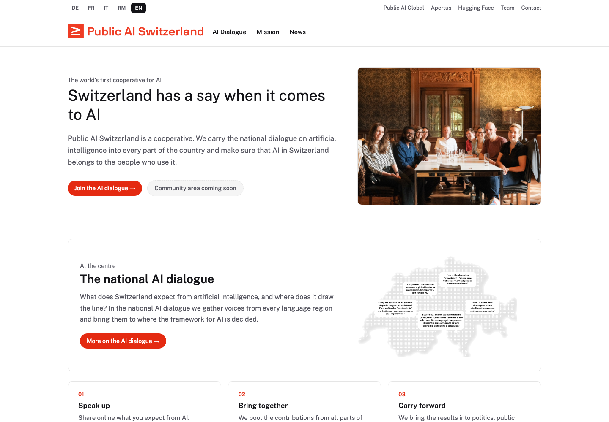
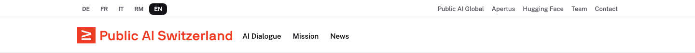
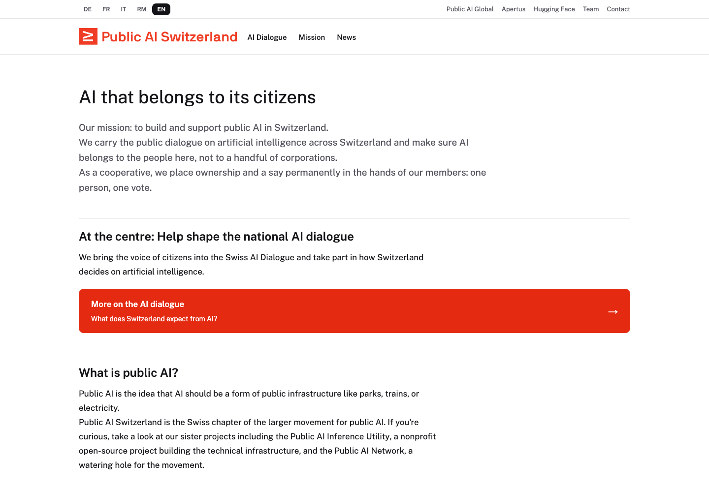
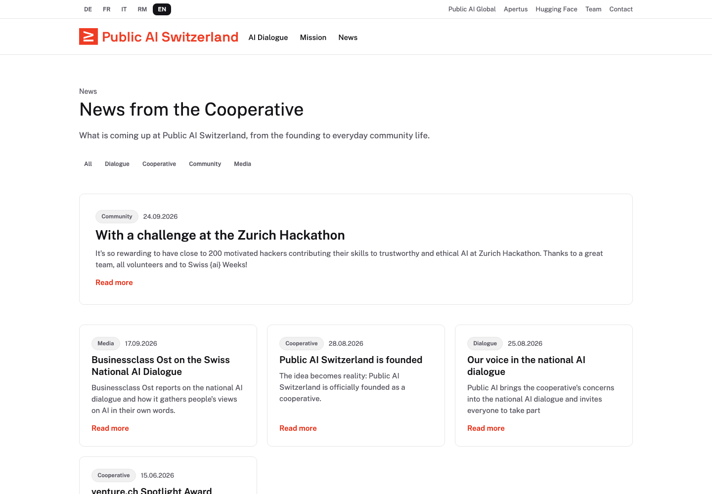
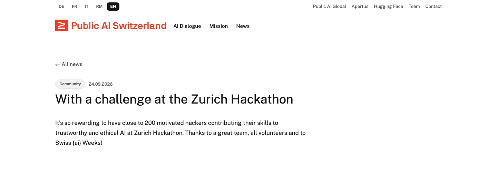
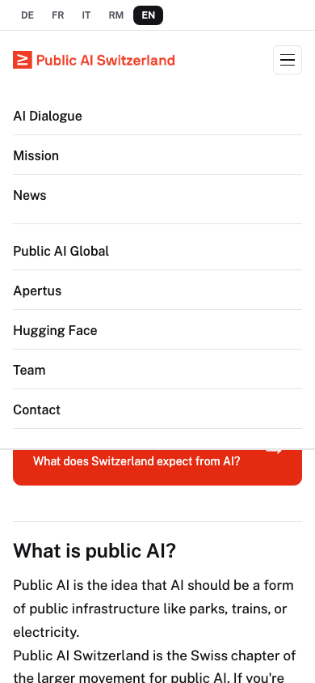

# Quick Guide for Content Contributors
A friendly handbook for updating pages, publishing news, and changing navigation.

You do not need to understand React to make everyday content changes. Most of the work happens in three places: page text in `content/`, images in `public/assets/`, and navigation in `config.json`.



This guide follows the repository as it stood on 2 November 2026. The screenshots show a local development preview of that code, not the deployed website. Example text and filenames are teaching examples, not edits made to the live site.

## Find what you need
2 - Where things live | 3 - Run a local preview | 4 - Edit a page | 5 - Create a page | 6 - Languages | 7 - Formatting and images | 8 - Publish news | 9 - Review news | 10 - Menus | 11 - Footer and mobile | 12 - Newsletter sign-up pages | 13 - Check and publish | 14 - Troubleshooting and sources

<!-- page -->
# 2. Where things live
Think of the repository as a shared working folder. The editable text and the program that displays it live side by side, but you usually only need a handful of files.

## Your everyday files
- `content/`: page text in MDX files. MDX is Markdown plus optional ready-made layout blocks.
- `content/news/`: articles. A filename looks like `2026-09-24-zurich-hackathon.mdx`.
- `content/templates/`: starting files to copy. Files here are never published as pages.
- `public/assets/`: images and downloads that visitors can load.
- `config.json`: header links, footer links, news categories, redirects, and a few site switches.
- `docs/`: tutorials, how-to guides, and technical references. This guide lives in `docs/pdf/`.

## Files you usually leave to developers
- `app/` maps addresses to pages. The home page starts in `app/routes/home.tsx`.
- `src/` holds shared components, styles, the content pipeline, and the home-page sections in `src/sections/home/`.
- `tests/` checks code and browser behaviour.
- `tools/` contains an optional MDX authoring skill.
- `build/client/` is generated by the production build. Never edit it to change page text; a rebuild overwrites it.

## Find a page from its address
The page at `/mission/` comes from `content/cooperative/mission.mdx`. The folder merely groups related files; it never appears in the address. The German version of the same page is `/de/mission/`.

News uses a different address shape: `content/news/2026-09-24-zurich-hackathon.mdx` becomes `/news/2026-09-24-zurich-hackathon/`.

The home page and the News listing are generated by code. There is no home-page MDX file and no `news.mdx` to edit. Publishing an article automatically updates both the News listing and the news teaser on the home page.

<!-- page -->
# 3. Run a local preview
A local preview lets you check your work before it reaches visitors. You need Git, Node.js 20 or newer, and the Yarn version pinned by the project. A text editor such as VS Code is helpful.

## First setup
If you do not have the repository yet:
```bash
git clone https://github.com/forpublicai/publicai.ch.git
cd publicai.ch
```
If you already have a local copy, open a terminal in that folder instead. Then run:
```bash
corepack enable
yarn install --immutable
yarn dev
```
Corepack provides the pinned Yarn version. If Corepack is missing or blocked by your machine's permissions, ask a technical maintainer for help. Use Yarn for this project rather than `npm install` — Yarn uses Plug'n'Play here, so the absence of a `node_modules` folder is normal.

## Open the address printed in the terminal
It is usually `http://localhost:5173/`. Keep the terminal open while you work: save a text edit, then look at the browser. Stop the server with Ctrl+C when you are done.

Restart `yarn dev` whenever you add or delete a file, add or remove a language section, or change a page's routing (for example its `draft` status). Ordinary wording edits refresh live. If a `config.json` edit looks stale, reload the page and restart the server.



The small top row holds the language switcher and utility links. The larger row holds the logo and the main menu. Both menus get their entries from `config.json`.

<!-- page -->
# 4. Change an existing page
Start with a small edit. You do not need a template to update a page that already exists.

## A simple editing routine
1. Find the MDX file whose filename matches the page address. For `/mission/`, open `content/cooperative/mission.mdx`.
2. Find the section for the language you want to change, for example `<!-- locale: en -->`.
3. Edit the text below that marker, stopping at the next language marker.
4. If the heading or summary changes too, update that language's title and description in the frontmatter at the top of the file.
5. Save, look at the page in the local preview, and run `yarn build` before handing over the change.



The large page heading comes from the title fields at the top of the file; the body comes from the language section. For an ordinary section heading in the body, use `## Heading` rather than adding a second main heading with `#`.

## The two parts of an MDX file
The block between the opening pair of `---` lines is the frontmatter: short settings such as title and description. Everything after it is body content, divided by language markers. Keep both parts in place while editing.

You can edit one language at a time, but a wording change does not translate itself. When a fact, date, link, or meaning changes, review the other language sections too.

<!-- page -->
# 5. Create a new page
Choose a short, stable filename using lowercase letters, numbers, and hyphens. It must be unique across the whole content tree. Avoid the reserved names `news` and `authors`.

## Copy the starting file
For example, to create a Workshops page:
```bash
mkdir -p content/community
cp content/templates/page-template.mdx content/community/workshops.mdx
```
You can also copy and rename the file in your editor. In the copy, delete the explanatory paragraph between the closing frontmatter `---` and the first language marker — no body text may sit before the first marker.

## A complete, small starting example
```mdx
---
title: Workshops
description: Meet the community and take part in our public AI workshops.
---

<!-- locale: en -->

Come and learn with us.

## What to expect

We share ideas, try tools, and learn together.

[Read our mission](/mission)
```
This creates the English page `/workshops/`. It does not create German, French, Italian, or Romansh pages until you add those sections — the example includes only English on purpose. Replace the placeholder text with approved content.

## Help visitors find the new page
Link to it from an existing page, or add a menu or footer entry in `config.json` (page 10). A new page does not add itself to the menu, and the production build fails if a published page is not reachable from the home pages.

Restart the development server, open `/workshops/`, and run `yarn build`. While you are still drafting, set `draft: true` in the frontmatter. Drafts have no routes, even in development; you cannot browse them until you remove the flag.

<!-- page -->
# 6. Write and check each language
The five language codes are `en` (English), `de` (German), `fr` (French), `it` (Italian), and `rm` (Romansh). One file holds every available translation of a page.

## Body text uses marker lines
```mdx
<!-- locale: en -->

Our next workshop is open to everyone.

<!-- locale: de -->

Unser nächster Workshop steht allen offen.
```
Each marker goes on its own line, each language is used at most once, and the order is flexible (the templates start with German). Leave a blank line after a marker. Keep at least one language section, and never leave empty sections that pretend to be finished translations.

Translations are the author's responsibility, not an automatic step. That is deliberate: some content, such as the statutes, must not be left to machine translation, and each translation should be reviewed by a person.

## Translate headings and summaries too
```yaml
title: Workshops
title_de: Workshops
title_fr: Ateliers
description: Discover our workshops and join the next community gathering.
description_de: Entdecken Sie unsere Workshops und das nächste Treffen.
```
`title` and `description` are required base fields. Add `title_en`, `title_de`, `title_fr`, `title_it`, `title_rm` and the matching `description_...` fields as needed. A missing override falls back to the English override, then the German override, then the base field. Set explicit overrides for each finished translation so headings never surprise anyone.

## Check the real addresses
English: `/workshops/`. German: `/de/workshops/`. The other languages use `/fr/`, `/it/`, and `/rm/` the same way. Only languages that have a marker get a page route; requesting a missing translation can 404 rather than fall back, so always click through while reviewing. The News listing exists in all five languages and can show a fallback title or excerpt, but that does not create a translated article. The build writes `untranslated-sections-report.txt` listing any missing sections when gaps exist.

<!-- page -->
# 7. Format text and add pictures
Most page content is ordinary Markdown that you can write directly.
```mdx
## A section heading

A paragraph with **bold words** and *emphasis*.

- First point
- Second point

[Our mission](/mission)
[An external resource](https://publicai.co)
```
Internal links such as `/mission` automatically get the current section's language prefix. Link only to pages that exist in the languages you publish. For a news article use its full path, for example `/news/2026-09-24-zurich-hackathon/`. Links into `/assets/` are downloads or images, not page slugs.

## Put images in the public assets folder
For example, save `workshop.jpg` in `public/assets/images/workshops/`. The address you write in MDX starts at `/assets/` — do not include `public`.
```mdx
<Figure
  src="/assets/images/workshops/workshop.jpg"
  alt="Participants discussing ideas around a workshop table"
  caption="A community workshop in Zurich."
/>
```
The image file must actually exist at that path; match spelling and capitalisation exactly. Write alt text that conveys the useful visual information, and translate the caption and alt text in each language section.

## Ready-made blocks can help
```mdx
<Lead>A short introduction that stands out.</Lead>

<Callout variant="info">
  Registration details will be shared soon.
</Callout>

<CTA title="Read our mission" to="mission" />
```
Component and property names are case-sensitive. `to="mission"` is a page slug without slashes; an external CTA uses `href="https://..."`. Keep exactly one of `to` or `href`. Reuse these blocks instead of inventing new styling. More options — stat grids, accordions, team cards, poster downloads, video embeds — are listed in `docs/reference/components.md`. Embeds only accept hosts listed in `config.json` under `embeds.allowlist`.

<!-- page -->
# 8. Publish a news article
A news article is an MDX page whose frontmatter contains both `date` and `category`. The folder alone does not make something news.

## Copy, rename, and clean the template
```bash
cp content/templates/news-template.mdx content/news/2026-11-09-community-workshop.mdx
```
Delete the explanatory text before the first language marker in your copy, and replace all placeholder titles, descriptions, and body sections. Start the filename with the publication date and make the frontmatter `date` match it.

## A small article example
```mdx
---
title: A community workshop
description: Our community explored public AI and planned the next steps.
date: 2026-11-09
category: Community
---

<!-- locale: en -->

We met to exchange ideas and learn together.

## What happens next

[Learn about our mission](/mission)
```
This would live at `/news/2026-11-09-community-workshop/`. Add real reporting and translations before publishing. As with pages, `draft: true` hides the article completely, including its preview route.

## Choose an existing category
The current choices in `config.json` under `news.categories` are `Dialog`, `Genossenschaft`, `Community`, `Medien`, and `Technik`. Match the spelling exactly. If you need a new category, add it to that list and review the resulting filter label.

`description` is the listing teaser, so write it to make sense on its own; use the per-language description fields for translated teasers. An optional `heroImage: /assets/images/news/workshop.jpg` supplies the card and article image — place the real file at the matching path under `public/`.

A future date does not schedule publication. Once an article is not a draft, the next build can show it regardless of the date, so keep it a draft until it is ready.

<!-- page -->
# 9. Review how the news appears
The site builds the News page for you. You never add a card to a list by hand, and you never edit the home page to announce an article.



Articles sort by their frontmatter date, newest first. The first page highlights the newest article as a featured card; the rest appear in a grid. The home teaser shows the latest three published articles. Category buttons filter the listing in place, and the listing shows up to ten articles per page. A category with no published articles does not appear as a filter.



## Two optional features
To point readers to reporting published elsewhere, add `externalUrl: https://example.org/article` to a news item. It shows in the listings but gets no local article route; its title and description still need real copy. Use the actual external address, not the example.

Author records live in `content/authors/`, and an article can reference one with `author: daria-hoehener`, for instance. The ID must match a real file. Author bylines and author pages are currently switched off for the release via `news.authorsEnabled: false` in `config.json`; adding an `author` field will not turn the feature on by itself.

<!-- page -->
# 10. Change the menu in config.json
Open `config.json` at the repository root. `menus.main` feeds the larger menu beside the logo; `menus.utility` feeds the smaller row above it. An optional `menus.cta` provides a prominent action button. The current config has no CTA and no dropdown menus.

## Add a page link
To link your Workshops page, add an object like this inside the `menus.main` array:
```json
{
  "label": {
    "en": "Workshops",
    "de": "Workshops",
    "fr": "Ateliers",
    "it": "Workshop",
    "rm": "Lavuratoris"
  },
  "page": "workshops"
}
```
The labels here illustrate the format — have translated wording reviewed by a person. All five language keys are required and must contain text. The `page` value is a filename slug without `.mdx`, folder, or slashes, and the target page must exist. The reserved value `news` opens the generated News listing.

## Keep the JSON punctuation intact
Entries sit between `[` and `]`, and each entry between `{` and `}`. Put a comma between neighbouring entries but not after the last one. JSON requires double quotes and allows no comments. Your editor can highlight a missing comma or bracket.

## Choose exactly one kind of target per item
- `page`: an internal page, for example `"page": "mission"`.
- `url`: an external address such as `"url": "https://publicai.co"`, or a `mailto:` address.
- `children`: a non-empty array of menu entries for a dropdown; each child needs its own label and target. Keep header dropdowns to one level.

Entries appear in array order, so move a whole object to reorder the menu. Removing a menu entry does not delete its page, but it can leave the page unreachable if nothing else links to it.

<!-- page -->
# 11. Footer links and the mobile menu
The footer is configured in `config.json` too. A footer entry uses the same five-language label and `page` or `url` target as a menu entry.


`footer.columns` is a list of columns, each with a translated `title` and an `items` array of links — edit a column or move a whole one to change the order. `footer.tagline` sets the short description above the columns and `footer.copyright` the bottom line, including the source-code and license links. All of them are five-language objects.

The footer also contains a compact newsletter sign-up form (below the tagline) served by the shared form component in `src/components/newsletter-form.tsx`; there is no `footer.newsletter` config switch — the form is always rendered.

## Check a narrow screen too


The same main and utility entries fold into the mobile menu. After a change, narrow the browser or use its device preview, open the menu button, and click your updated link. Check that long translations fit and that the menu closes after navigating.

<!-- page -->
# 12. Newsletter sign-up pages
The newsletter form on the home page and in the footer posts to per-language Infomaniak webforms. After a successful sign-up, visitors land on a hidden confirmation page; clicking the confirmation link in the email lands them on a validation page. Both exist as `content/cooperative/newsletter-confirmation.mdx` and `content/cooperative/newsletter-validation.mdx`, carry `noindex: true`, and are listed in `pages.excluded`, so they are routed but kept out of the sitemap and the reachability check. Edit their MDX like any other page. The members placeholder page works the same way: `content/cooperative/members.mdx`, noindex, shown when someone clicks "Become a member" before the members area exists.

<!-- page -->
# 13. Check your work and publish
A saved file changes your local preview, not the live website. The deployed site serves generated HTML, so content changes need a new build and deployment.

## Before you hand over a change
1. Read the page in every language you changed — heading, summary, body, links, and images.
2. For a new page, make sure a menu, footer, or existing page links to it. For news, check the listing and open the article.
3. Look at a narrow screen and open the mobile menu if you changed navigation.
4. Build the site, then browse the built version:
```bash
yarn build
yarn preview
```
The preview is usually `http://localhost:4173/`; use whatever the terminal prints. `yarn build` validates content and references, renders the static pages, verifies links and reachability, and writes the sitemap and reports.

## The complete repository checks
These separate commands are used for release validation:
```bash
yarn lint
yarn typecheck
yarn test
yarn build
yarn test:e2e
```
Browser tests need Chromium, installed with `yarn playwright install chromium`.

## Hand over the source changes
Follow your team's review process. Include the MDX, config, and asset files you changed, and say which languages you checked. Keep generated output and local dependency caches out of the submission.

In this repository a GitHub workflow checks pull requests, and upstream `main` builds and deploys through the configured FTP job. A local edit or a fork does not deploy by itself. For a manual upload only `build/client/` is the deployment artifact — see `docs/deploy/server-admin-guide.md` and the maintainer's process first.

<!-- page -->
# 14. When something goes wrong
Build errors usually name the file or configuration field to fix. Start there, save the correction, and build again.

- **Content before the first locale marker:** delete the template's instruction paragraph between the frontmatter and the first marker. All body content belongs after a marker.
- **Unknown or duplicate locale:** use only `en`, `de`, `fr`, `it`, `rm`, one marker per language.
- **Duplicate slug:** another page has the same filename, even in another folder. Pick a unique filename before publishing.
- **Invalid frontmatter:** check the required `title` and `description`, the `---` delimiters, and field spellings. Use flat single-line `key: value` entries; this parser does not support nested YAML or multiline descriptions.
- **Unknown category or author:** use a category from `news.categories`, or an author ID with a real file in `content/authors/`.
- **Invalid config or missing label:** check commas, brackets, and that every label has all five language keys. An error like `menus.main.2.label.fr` points into the third main-menu item; array positions start at zero.
- **Unreachable page:** link to it from an existing reachable page or from navigation. `pages.excluded` exempts a page from the sitemap and reachability checks but does not hide or delete its route.
- **404 in the preview:** check the slug, the language marker, and the draft status, then restart `yarn dev`. Link-out news and missing translations have no local route.
- **Wrong translated heading:** set that language's `title_...` and `description_...` fields explicitly.

## If you rename or remove a published page
Old links can live on in emails and search results. Update incoming links and menu entries, and add old-to-new paths in `pages.redirects` where useful:
```json
{ "from": "/old-page/", "to": "/mission/" }
```
Add the translated paths as needed. Redirects are generated forwarding pages, not automatic preservation of every old address. `noindex: true` keeps a route accessible but asks search engines not to index it; `draft: true` removes the route entirely.

## Sources and accuracy notes
Based on the root `README.md` and `CONTRIBUTING.md`, `docs/tutorials/first-page-in-15-minutes.md`, the how-to guides for pages, news, menus, and exclusions, and the frontmatter, component, config, URL-scheme, and build-gate references. Behaviour was checked against `app/routes.ts`, `src/lib/mdx-page-model.ts`, `src/lib/config.ts`, the header and footer renderers, and the actual `config.json`.

Where older prose disagreed, this guide follows the code: translated metadata is supported; drafts have no dev routes; missing language sections have no page routes; both templates contain pre-marker instructions; authors are disabled for the release; the footer newsletter is a rendered component, not a config switch. Screenshots were captured from this repository's local preview on 8 October 2026.
